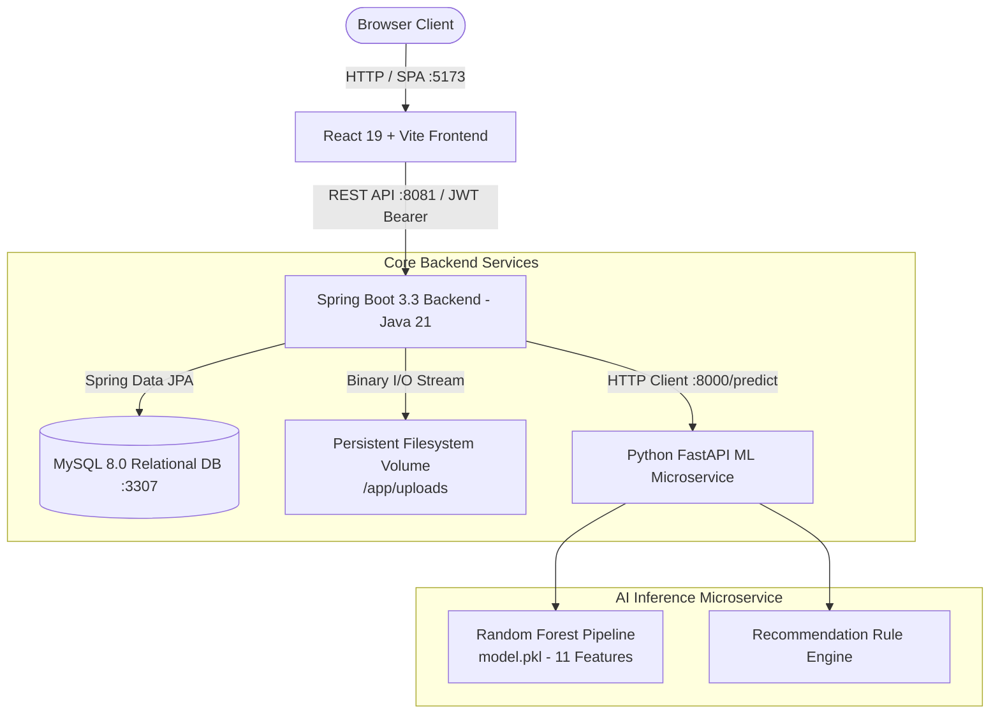

# AI-AcadPredict 🎓🤖
### AI-Integrated Academic Project Management & Delay Risk Prediction Platform

[](https://react.dev/)
[](https://spring.io/projects/spring-boot)
[](https://openjdk.org/)
[](https://fastapi.tiangolo.com/)
[](https://scikit-learn.org/)
[](https://www.mysql.com/)
[](https://www.docker.com/)

---

## 📌 Table of Contents
1. [Overview & Value Proposition](#-overview--value-proposition)
2. [System Architecture](#-system-architecture)
3. [Key Modules & Capabilities](#-key-modules--capabilities)
4. [Role-Based Access Control (RBAC)](#-role-based-access-control-rbac)
5. [AI Delay Risk Prediction Engine](#-ai-delay-risk-prediction-engine)
6. [Technology Stack](#-technology-stack)
7. [Repository Structure](#-repository-structure)
8. [Quick Start with Docker Compose](#-quick-start-with-docker-compose)
9. [Pre-Configured Test Credentials](#-pre-configured-test-credentials)
10. [REST API Reference Overview](#-rest-api-reference-overview)
11. [Testing & Quality Verification](#-testing--quality-verification)
12. [Comprehensive Documentation Index](#-comprehensive-documentation-index)

---

## 🚀 Overview & Value Proposition

**AI-AcadPredict** is an enterprise-grade university project management platform and proactive delay risk prediction engine. Designed to replace fragmented spreadsheets and disconnected chat threads, it unifies student development teams, academic supervisors, and project coordinators within a single, role-governed web application.

### Why AI-AcadPredict?
- **Real-Time Data Integrity:** 100% driven by genuine MySQL relational queries; zero synthetic or mocked statistics on dashboards.
- **Machine Learning Early-Warning System:** Evaluates 11 quantitative sprint and team velocity metrics through a trained Random Forest model to predict delay probabilities and calendar delay days before deadlines are breached.
- **Academic Governance & Workload Optimization:** Department coordinators manage faculty allocations and follow-ups, while faculty guides evaluate milestones with structured feedback and track student progress.
- **Hybrid Storage Architecture:** Database stores transactional entities and document metadata, while binary project artifacts (PDF, DOCX, ZIP) are persisted directly to secure filesystem storage.
- **Production-Ready Multi-Container Deployment:** One-command setup orchestrating React, Spring Boot, Python FastAPI, and MySQL with volume persistence and health checks.

---

## 🏗 System Architecture



---

## 🎯 Key Modules & Capabilities

### 1. Differentiated Role Dashboards
- **Student Dashboard:** Personal active project status, overall progress percentage, milestone count and deadlines, real-time AI delay risk level, and quick links to submit proposals and update tasks.
- **Faculty Dashboard:** Supervision-centric control room featuring 5 genuine backend metrics:
  - *Assigned / Supervised Projects* count
  - *Department Proposals Pending Review* count
  - *Assigned Projects with Upcoming Milestones*
  - *Assigned Projects with Overdue Milestones*
  - *Assigned Projects with Genuine HIGH Delay Risk*
  - Direct action modals: "+ Add Student Account", "Supervisor Feedback & Milestone Review", "Assign Student to Task", and direct proposal review queue.
- **Coordinator Dashboard:** Departmental oversight command center featuring 7 genuine backend metrics:
  - *Total Department Projects*, *Awaiting Review*, *Approved*, *Rejected*
  - *Projects with No Assigned Faculty Guide*
  - *Projects with Overdue Milestones*
  - *Projects with Genuine HIGH Delay Risk*
  - Direct action controls: "+ Add User Account" (Student or Faculty), "Faculty Workload & Assignment Overview" table, "Department Review History & Follow-Up Tracking" modal, and direct faculty guide allocation.

### 2. Project Lifecycle & Proposal Review Workflow
- **Classified Tabs:** *All Proposals*, *Pending Review*, *Approved*, and *Rejected*.
- **Supervisor Review:** Faculty and Coordinator can approve or reject proposals with persisted academic review feedback, reviewer name, and timestamps.
- **Persistent Progress Slider:** 0–100% persistent project progress tracking stored in MySQL and editable by authorized owners and guides.
- **Safe Project Deletion:** Hard-delete confirmation requiring the user to type the exact project title; executes clean cascading removal of filesystem documents and all dependent database records.

### 3. Sprint Tasks & Milestone Management
- **Task Delegation:** Prioritize tasks (`LOW`, `MEDIUM`, `HIGH`, `CRITICAL`), set due dates, update progress, and assign tasks to registered project team members with automatic assignee name resolution.
- **Milestone Evaluation:** Faculty supervisors evaluate project milestones (`REVIEWED`, `NEEDS_ATTENTION`, `PENDING_REVIEW`) with recorded evaluation feedback.

### 4. Hybrid Document Management
- Upload project charters, SRS, architecture specs, and code bundles up to 15MB.
- Document binary bytes are stored on the persistent host/container filesystem; metadata is stored in MySQL.
- Secure, authenticated downloads using JWT verification and proper `Content-Disposition` headers.

---

## 🔒 Role-Based Access Control (RBAC)

The system enforces strict role-based access control governed by Spring Security filters and domain services. Only **three** authorized roles exist:

| Role | Target User | Capabilities | Provisioning Method |
|---|---|---|---|
| **`STUDENT`** | Undergraduate / Postgraduate students | Create & manage self-owned projects, update progress, manage tasks, assign team members, manage milestones, upload documents, run AI predictions. Cannot review proposals. | **1. Public Registration:** Self-registration at `/register`.<br>**2. Staff Provisioning:** Added by Faculty or Coordinator. |
| **`FACULTY`** | Project Guides / Supervisors | View supervised and department projects, review proposals with feedback, evaluate milestones, assign project tasks, provision Student accounts. | **1. Coordinator Provisioning:** Added via Coordinator dashboard.<br>**2. Seeder:** Pre-configured via development seed. |
| **`COORDINATOR`** | Department HOD / Project Coordinator | Department-wide oversight, allocate/reassign faculty guides, monitor faculty workload, record follow-up notes, provision Student and Faculty accounts, delete projects. | **1. Seeder:** Pre-configured via development seed.<br>**2. Institutional DBA:** Direct database insert. |

> [!NOTE]
> **No `ADMIN` Role:** There is deliberately no `ADMIN` role in AI-AcadPredict. Departmental oversight is fully handled by `COORDINATOR`. Any attempt to provision an `ADMIN` role returns `HTTP 400 Bad Request`.

---

## 🧠 AI Delay Risk Prediction Engine

The AI microservice is built with **FastAPI** and runs a trained **Random Forest** regression pipeline that evaluates 11 quantitative academic metrics:

```json
{
  "projectId": 12,
  "attendance": 85.0,
  "studyHours": 24.5,
  "previousPerformance": 78.0,
  "taskCompletion": 65.0,
  "pendingTasks": 4,
  "missedDeadlines": 1,
  "milestoneCompletion": 50.0,
  "daysRemaining": 45,
  "teamSize": 4,
  "projectType": 1,
  "projectProgress": 55
}
```

### Prediction Output & Risk Classification
- **Risk Level:** `LOW` (Delay probability < 35%), `MEDIUM` (35%–65%), `HIGH` (> 65%).
- **Predicted Delay Days:** Estimated calendar delay from nominal schedule.
- **Confidence Score:** Model certainty based on feature vector consistency.
- **Actionable Recommendations:** Automated mitigation advice generated by the built-in recommendation engine (e.g. task reallocation, emergency supervisor check-in).

---

## 💻 Technology Stack

| Layer | Technologies | Key Libraries / Frameworks |
|---|---|---|
| **Frontend** | React 19, Vite, Vanilla CSS Tokens | React Router DOM v7, Chart.js / Recharts |
| **Backend** | Spring Boot 3.3.4, Java JDK 21 LTS | Spring Security, Spring Data JPA, JJWT, Hibernate |
| **AI Microservice** | Python 3.11, FastAPI | scikit-learn, NumPy, Pandas, Pydantic v2, Uvicorn |
| **Database** | MySQL 8.0 Community Server | InnoDB Engine, Foreign Key Cascades |
| **Containerization** | Docker, Docker Compose v2 | Multi-stage builds, Alpine base images, Named Volumes |

---

## 📁 Repository Structure

```
AI-AcadPredict/
├── ai-service/                   # Python FastAPI Machine Learning Microservice
│   ├── data/raw/                 # Dataset generation and synthetic training sets
│   ├── models/                   # Serialized Random Forest model pipeline (model.pkl)
│   ├── src/                      # FastAPI app (main.py, preprocessing.py, schemas.py)
│   ├── tests/                    # 12 automated unit/integration tests
│   ├── Dockerfile
│   └── requirements.txt
├── frontend/                     # React 19 + Vite Single Page Application
│   ├── src/
│   │   ├── components/layout/    # Unified navigation layout (StudentLayout.jsx)
│   │   ├── pages/auth/           # Login.jsx, Register.jsx (with Show/Hide password toggles)
│   │   ├── pages/student/        # Role-based dashboards & project lifecycle modules
│   │   └── services/api.js       # Centralized JWT HTTP client
│   ├── Dockerfile
│   └── package.json
├── spring-backend/               # Spring Boot 3.3 Java 21 REST API
│   ├── src/main/java/com/acadpredict/backend/
│   │   ├── config/               # SecurityConfig, CorsConfig, DevAccountInitializer
│   │   ├── controller/           # Project, Task, Milestone, Team, User, Prediction APIs
│   │   ├── dto/                  # Request & response records
│   │   ├── entity/               # User, Project, Task, Milestone, TeamMember, Document
│   │   ├── repository/           # Spring Data JPA repositories
│   │   └── service/              # DocumentStorageService, AiPredictionService, AuthService
│   ├── Dockerfile
│   └── pom.xml
├── docker-compose.yml            # Multi-container orchestration specification
├── ACADPREDICT_USER_GUIDE.md     # Complete operational manual
├── ACADPREDICT_ROLE_ACCESS_MATRIX.md # Detailed role and security permissions matrix
├── ACADPREDICT_API_REFERENCE.md  # Comprehensive REST API specifications
├── ACADPREDICT_DEMO_CHECKLIST.md # Live demonstration script & presentation checklist
└── MEMBER4_AUDIT_REPORT.md       # Comprehensive system audit and verification report
```

---

## ⚡ Quick Start with Docker Compose

### Prerequisites
- [Docker Desktop](https://www.docker.com/products/docker-desktop/) (Version 24.0+ recommended) with Docker Compose v2.
- A modern web browser.

### 1. Clone & Start Containers
Run the following in PowerShell or terminal from the repository root:

```powershell
# 1. Validate Docker Compose configuration
docker compose config -q

# 2. Build and start all 4 services in detached mode
docker compose up -d --build

# 3. Check health status
docker compose ps
```

### 2. Service Access Points

| Service | Host URL | Description |
|---|---|---|
| **Web Application** | `http://localhost:5173` | React Single Page Application |
| **Backend REST API** | `http://localhost:8081` | Spring Boot API |
| **Backend Health Check** | `http://localhost:8081/api/health` | Health & DB connectivity status |
| **AI Microservice Health** | `http://localhost:8000/health` | Model status (`{"status":"healthy"}`) |
| **AI Swagger Documentation** | `http://localhost:8000/docs` | Interactive OpenAPI playground |
| **MySQL Database** | `localhost:3307` | MySQL Server port mapped from 3306 |

### 3. Safe Shutdown & Restart
```powershell
# Safely halt services without losing database or uploaded files
docker compose down

# Restart running containers
docker compose restart
```

> [!WARNING]
> Do **NOT** run `docker compose down -v` unless you explicitly want to erase your persistent MySQL database and all uploaded project documents!

---

## 🔑 Pre-Configured Test Credentials

When starting with development provisioning enabled (`DEV_PROVISION_ACCOUNTS=true` in `docker-compose.yml`), the following accounts are initialized with BCrypt password hashing:

| Role | Email Address | Password | Display Name | Scope |
|---|---|---|---|---|
| **`COORDINATOR`** | `coordinator@college.edu` | `CoordinatorPass123!` | Prof. Williams | Department-wide oversight, guide allocation, follow-ups |
| **`FACULTY`** | `faculty@college.edu` | `FacultyPass123!` | Dr. Sharma | Supervision view, proposal review, milestone evaluation |
| **`STUDENT`** | Register fresh at `/register` | User chosen | User chosen | Personal project ownership, tasks, documents |

---

## 📡 REST API Reference Overview

All protected endpoints require an `Authorization: Bearer <jwt_token>` header.

### Authentication & Users
- `POST /api/auth/register` — Public student registration.
- `POST /api/auth/login` — Authenticate and receive JWT.
- `POST /api/users` — Staff account creation (Faculty: Student only; Coordinator: Student or Faculty).
- `GET /api/users/faculty` — List active faculty members.
- `GET /api/users/students` — List active student members.

### Projects & Supervision
- `GET /api/projects` — Get projects (Students: owned projects; Staff: all department projects).
- `POST /api/projects` — Submit project proposal.
- `PUT /api/projects/{id}/progress` — Update project progress (0–100%).
- `PUT /api/projects/{id}/assign-guide` — Coordinator allocates or reassigns faculty guide.
- `PUT /api/projects/{id}/review` — Faculty/Coordinator reviews proposal with academic feedback.
- `PUT /api/projects/{id}/follow-up` — Coordinator records departmental tracking note.
- `DELETE /api/projects/{id}` — Safe cascading deletion of project, filesystem documents, and records.

### Tasks & Milestones
- `POST /api/tasks` — Create task with assignee selection (`assignedToId`).
- `PUT /api/tasks/{id}` — Update task status, priority, due date, or assignee.
- `DELETE /api/tasks/{id}` — Delete task.
- `POST /api/projects/{id}/milestones` — Create project milestone.
- `PUT /api/milestones/{id}/review` — Supervisor evaluates milestone (`REVIEWED`, `NEEDS_ATTENTION`).

### Documents & AI Inference
- `POST /api/documents/upload` — Multipart file upload to persistent filesystem storage.
- `GET /api/documents/{id}/download` — Authenticated stream download with content disposition.
- `POST /api/predictions/predict` — Trigger Random Forest ML inference and log prediction to MySQL.

*For complete schemas, request/response payloads, and error codes, see [ACADPREDICT_API_REFERENCE.md](ACADPREDICT_API_REFERENCE.md).*

---

## 🧪 Testing & Quality Verification

AI-AcadPredict includes a full suite of automated unit, integration, and security verification tests:

| Test Suite | Scope | Command | Outcome |
|---|---|---|---|
| **Spring Boot Unit & Integration** | 58 JUnit 5 tests covering security, controllers, RBAC, and cascading deletion | `cd spring-backend && mvn test` | **58 passed, 0 failed, 0 errors** |
| **Frontend Code Quality** | ESLint static analysis across React components | `cd frontend && npm run lint` | **0 errors, 0 warnings** |
| **Frontend Production Build** | Vite production bundling | `cd frontend && npm run build` | **Clean build (< 500ms)** |
| **FastAPI ML Tests** | 12 pytest unit and integration tests | `cd ai-service && pytest` | **12 passed, 0 failed** |
| **Live End-to-End Test Suite** | 8-phase PowerShell live container verification script | `powershell -File scratch/verify_all_new_features.ps1` | **100% Pass Rate** |

---

## 📚 Comprehensive Documentation Index

Explore the dedicated documentation files for in-depth technical details:

1. 📖 **[ACADPREDICT_USER_GUIDE.md](ACADPREDICT_USER_GUIDE.md)**: Complete operational manual for students, supervisors, coordinators, and examiners.
2. 🛡️ **[ACADPREDICT_ROLE_ACCESS_MATRIX.md](ACADPREDICT_ROLE_ACCESS_MATRIX.md)**: Exhaustive security matrix, route authorization, and privilege boundaries.
3. 📑 **[ACADPREDICT_API_REFERENCE.md](ACADPREDICT_API_REFERENCE.md)**: Full REST API specification with example payloads and status codes.
4. 📋 **[ACADPREDICT_DEMO_CHECKLIST.md](ACADPREDICT_DEMO_CHECKLIST.md)**: Step-by-step presentation script, examiner demonstration sequence, and SQL proof queries.
5. 📊 **[MEMBER4_AUDIT_REPORT.md](MEMBER4_AUDIT_REPORT.md)**: Member 4 comprehensive audit report detailing all implementation phases, architecture decisions, and test outcomes.

---

## 👥 Contributors & Academic Context

- **Platform:** AI-AcadPredict (Advanced Software Engineering Project)
- **Target Institution:** KL University (KLH)
- **Auditor & Lead Integrator:** Member 4 (Database Management, Testing, Integration Testing, and Docker Verification)
- **License:** Academic Project Evaluation & Educational Use Only

